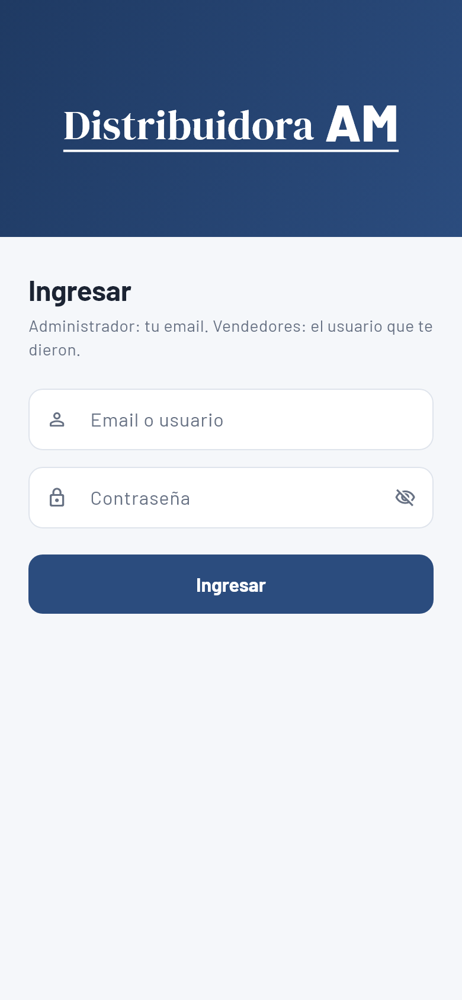
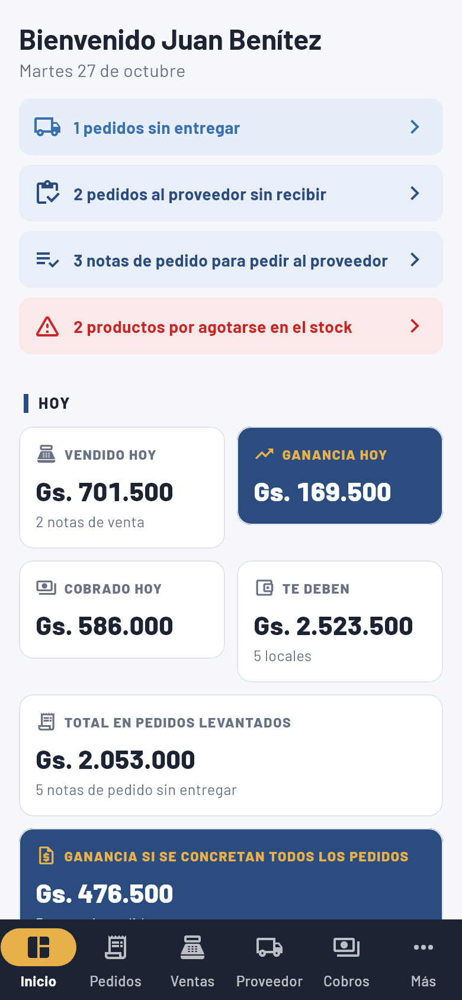
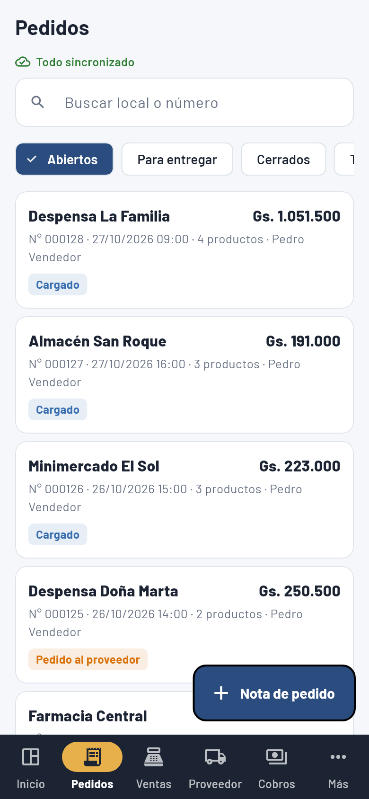
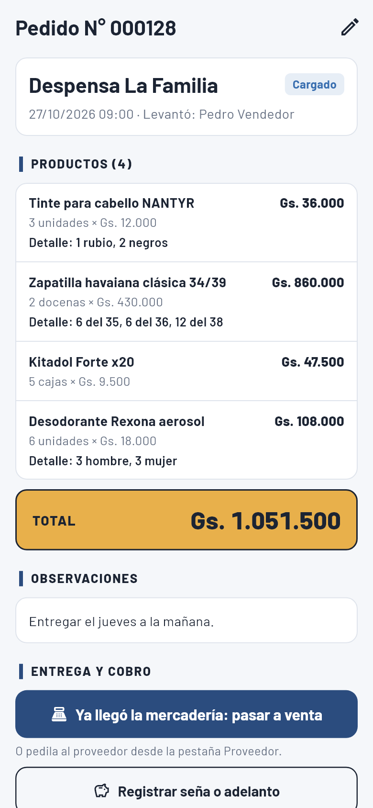
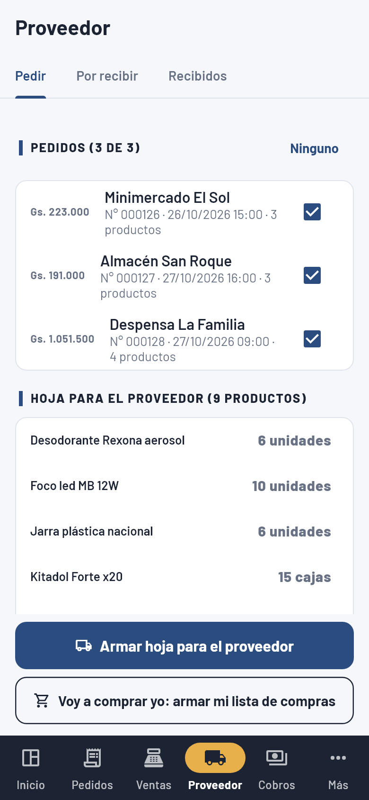
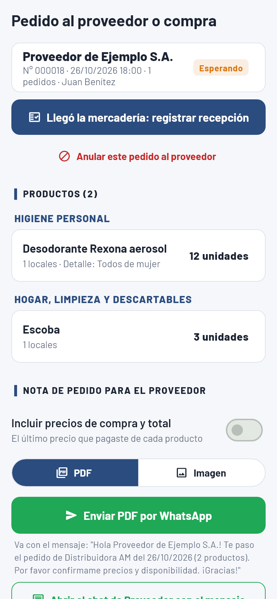
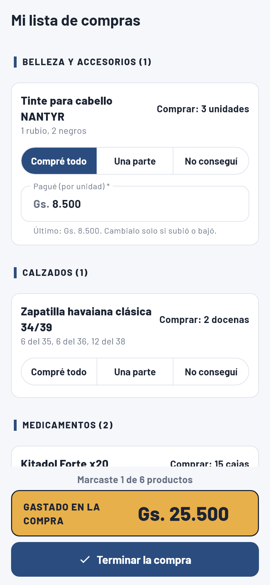
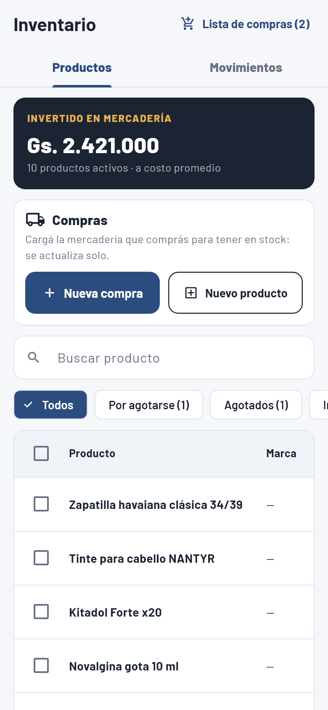
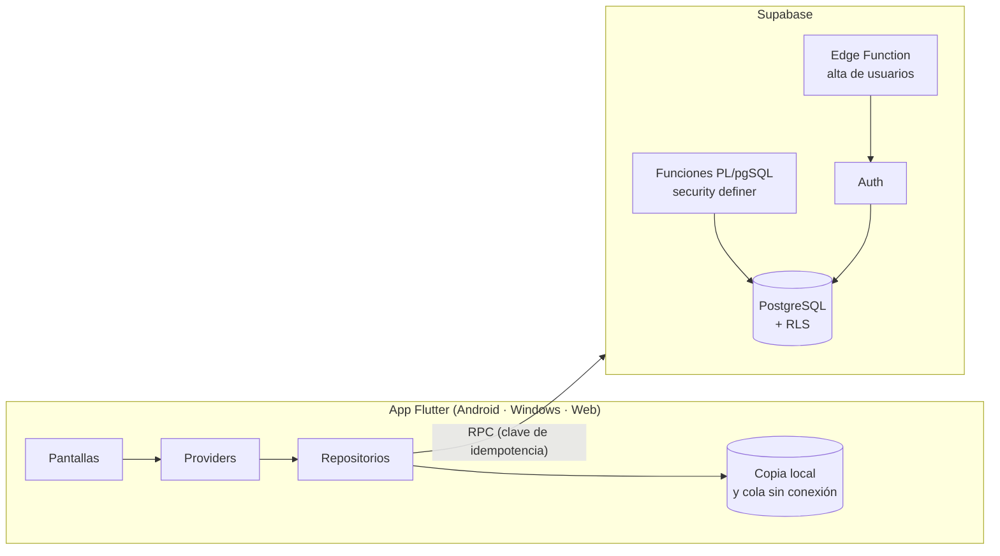

# Sistema de Pedidos y Cobros

**Aplicación de gestión comercial para una distribuidora mayorista, en uso diario en producción.**

Cubre el ciclo completo de una distribuidora que vende a almacenes, despensas y farmacias:
los vendedores levantan **notas de pedido** en la calle (incluso sin señal), el sistema las
**consolida en una hoja para el proveedor** o en una **lista de compras**, registra lo que llega,
**entrega y factura**, controla el **fiado y los cobros**, el **inventario** y muestra la
**ganancia** en tiempo real.

Hecha con **Flutter** (Android, Windows y Web) y **Supabase** (PostgreSQL con lógica de negocio en
el servidor, seguridad por filas y operaciones idempotentes).

> En uso en **Distribuidora AM** (Paraguay) por el administrador y los vendedores.
> Las capturas usan **datos de ejemplo**, no datos reales de la empresa ni de sus clientes.

---

## Capturas

| Ingreso | Inicio | Notas de pedido | Nota de pedido |
|:---:|:---:|:---:|:---:|
|  |  |  |  |

| Pedir al proveedor | Hoja del proveedor | Lista de compras | Inventario |
|:---:|:---:|:---:|:---:|
|  |  |  |  |

---

## Qué resuelve

| Módulo | Funcionalidad |
|---|---|
| **Notas de pedido** | Búsqueda por código o nombre, filtro por categoría, formas de venta (unidad / docena / caja), detalle por producto (colores, talles), descuentos, seña. |
| **Modo sin conexión** | El vendedor levanta pedidos sin señal: se guardan en el teléfono con un **número definitivo** (bloques de numeración reservados por dispositivo) y se suben solos al volver la señal, sin duplicados. |
| **Proveedor** | Consolida las notas en una hoja por proveedor, separada por categoría, y la envía por WhatsApp en PDF o imagen. Se puede anular mientras no llegue la mercadería. |
| **Lista de compras** | Para cuando el administrador compra él mismo: arma la lista con todo lo pendiente y va marcando *Compré todo / Una parte / No conseguí*. El avance se guarda en el teléfono. |
| **Recepción** | Por producto: llegó completo, una parte (con reparto entre los locales) o no llegó. Los parciales esperan la confirmación del local. |
| **Entrega y factura** | Convierte la nota en venta: confirma cantidades, cobra (efectivo, transferencia o QR, total o parcial) y emite factura con timbrado o nota de venta. |
| **Cobros y fiado** | Deuda por local, recibos, recordatorio por WhatsApp y aplicación automática de pagos a las ventas pendientes. |
| **Inventario** | Stock en la unidad base, costo promedio ponderado, movimientos, compras, lista de reposición y alertas de stock bajo. |
| **Inicio** | Vendido y ganancia del día, la semana, el mes y el año; total levantado en pedidos y ganancia estimada si se concretan todos. |
| **Usuarios** | Administrador y vendedores con permisos distintos: el vendedor nunca ve costos, márgenes ni precios de compra. |
| **Historial** | Auditoría de cada operación: quién la hizo, cuándo y qué cambió. |

---

## Arquitectura



**Decisiones técnicas destacadas**

- **La lógica de negocio vive en la base de datos.** Cada operación (guardar pedido, consolidar,
  recibir, entregar, cobrar, anular) es una función PL/pgSQL que valida, bloquea las filas
  necesarias (`for update`) y deja todo consistente en una sola transacción. La app nunca escribe
  tablas directamente.
- **Idempotencia en todas las escrituras.** Cada operación viaja con una clave única; si se corta la
  señal y la app reintenta, el servidor devuelve el resultado anterior en vez de duplicar la venta,
  el cobro o el pedido (tabla `operaciones` + `reservar_clave` / `guardar_resultado`).
- **Offline-first para la venta en la calle.** Cola local por usuario, copia de locales y productos,
  y numeración definitiva desde el teléfono mediante bloques reservados en el servidor.
- **Seguridad por filas (RLS) y por rol.** Las tablas no se exponen; el vendedor recibe los datos
  sin costos ni precios de compra. Las claves públicas se inyectan en la compilación
  (`--dart-define-from-file`), nunca en el código.
- **Unidades y presentaciones.** El stock se lleva en la unidad base y cada línea guarda su forma de
  venta y su factor (por ejemplo, la docena = 12): el stock, el costo y la ganancia siempre cierran.
- **Documentos.** Nota de pedido, nota de venta, factura con timbrado (formato talonario), recibo,
  hoja del proveedor y recepción, en PDF o imagen, en blanco y negro para imprimir barato.

---

## Tecnologías

| Capa | Tecnología |
|---|---|
| App | Flutter 3, Dart 3, Provider, Material 3 |
| Backend | Supabase: PostgreSQL, PL/pgSQL, Row Level Security, Auth, Edge Functions (Deno / TypeScript) |
| Documentos | `pdf`, `printing`, `share_plus`; guardado nativo en Android (MediaStore) por *method channel* en Kotlin |
| Sin conexión | `shared_preferences` (cola y copia local por usuario) |
| Seguridad | `flutter_secure_storage`, desbloqueo con huella (`local_auth`) |
| Distribución | APK por arquitectura e instalador de Windows con Inno Setup |

---

## Estructura

```
lib/
  data/           conexión con Supabase, sesión, copia local y claves de idempotencia
  models/         pedido, línea, producto (con presentaciones), venta, consolidado…
  repositories/   un repositorio por módulo; cada escritura es una RPC con su clave
  providers/      sesión, negocio, sincronización sin conexión
  screens/        pedidos, proveedor, ventas, cobros, inventario, reportes, configuración
  services/       PDF (notas, factura, hoja del proveedor), compartir y guardar archivos
supabase/
  migrations/     esquema, funciones y permisos (17 migraciones)
  functions/      Edge Function para dar de alta usuarios
  tests/          pruebas del circuito completo contra la base, dentro de una transacción
test/             pruebas de modelos, PDF, modo sin conexión y capturas con datos de ejemplo
```

---

## Cómo correrlo

1. Crear un proyecto en Supabase y aplicar las migraciones de `supabase/migrations` en orden.
2. Copiar `.env.example` a `.env` y completar la URL y la clave **pública** (*publishable*) del proyecto.
3. Ejecutar:

```bash
flutter pub get
flutter run --dart-define-from-file=.env
```

**Compilar**

```bash
flutter build apk --release --split-per-abi --dart-define-from-file=.env   # Android
flutter build windows --release --dart-define-from-file=.env               # Windows
flutter build web --release --dart-define-from-file=.env                   # Web
```

El instalador de Windows se genera con `windows/installer/pedidos_y_cobros.iss` (Inno Setup).

---

## Pruebas

```bash
flutter test                                                 # modelos, PDF, modo sin conexión
CAPTURAS_DIR=docs/capturas flutter test test/capturas         # vuelve a generar las capturas
```

Además, `supabase/tests/*.sql` recorre el circuito completo en la base real dentro de un bloque que
se deshace al final: pedido → hoja del proveedor → recepción parcial → confirmación → entrega con
factura y cobro, idempotencia, formas de venta y permisos del vendedor.

---

## Autor

Desarrollado por [@GabrielLeon1111](https://github.com/GabrielLeon1111) para Distribuidora AM:
relevamiento, diseño, desarrollo, puesta en producción y soporte.
