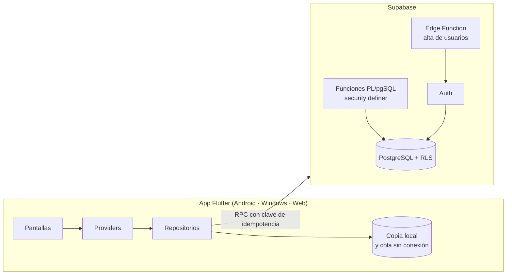

# Distribuidora AM · Pedidos, proveedor y cobros


App para **Distribuidora AM**, una distribuidora mayorista de Paraguay que vende a despensas,
almacenes y farmacias. Cubre el ciclo completo del negocio: los vendedores levantan **notas de
pedido** en la calle (incluso sin señal), el sistema las junta en una **hoja para el proveedor** o
en una **lista de compras**, registra lo que llega, **entrega y factura**, controla el **fiado y
los cobros**, el **inventario** y muestra la **ganancia** al instante.

Funciona en el **celular (APK de Android)**, en la **computadora (instalador de Windows)** y en el
navegador. Los datos viven en **Supabase**, así que el administrador y los vendedores ven lo mismo.

> **En producción:** la usan todos los días el administrador y los vendedores de la distribuidora.

## Capturas

<table>
  <tr>
    <td align="center"><br><b>Inicio</b><br>Vendido, ganancia y lo que falta concretar</td>
    <td align="center"><br><b>Notas de pedido</b><br>Estado de cada nota y sincronización</td>
    <td align="center"><br><b>Nota de pedido</b><br>Docenas, cajas y detalle por producto</td>
    <td align="center"><br><b>Ingreso</b><br>Administrador y vendedores</td>
  </tr>
  <tr>
    <td align="center"><br><b>Pedir al proveedor</b><br>Junta todas las notas en una hoja</td>
    <td align="center"><br><b>Hoja del proveedor</b><br>Separada por categoría, por WhatsApp</td>
    <td align="center"><br><b>Lista de compras</b><br>Se marca lo comprado mientras se compra</td>
    <td align="center"><br><b>Inventario</b><br>Stock, costo promedio y reposición</td>
  </tr>
</table>

> Las capturas usan **datos de ejemplo**, no datos de la empresa ni de sus clientes. Se generan solas
> con `CAPTURAS_DIR=docs/capturas flutter test test/capturas/capturas_test.dart`.

---

## Índice

1. [Qué hace](#qué-hace)
2. [Roles: administrador y vendedor](#roles-administrador-y-vendedor)
3. [Arquitectura y decisiones técnicas](#arquitectura-y-decisiones-técnicas)
4. [Tecnologías](#tecnologías)
5. [Estructura del proyecto](#estructura-del-proyecto)
6. [Puesta en marcha](#puesta-en-marcha)
7. [Base de datos (Supabase)](#base-de-datos-supabase)
8. [Compilar e instalar](#compilar-e-instalar)
9. [Pruebas](#pruebas)
10. [Seguridad](#seguridad)
11. [Convenciones del código](#convenciones-del-código)
12. [Autor](#autor)

---

## Qué hace

### Notas de pedido
- Buscador por código o primeras letras, con **filtro por categoría** (Medicamentos, Calzados, Bazar…).
- **Formas de venta:** un mismo producto se vende por unidad, docena, paquete o caja, cada forma con
  su precio. El stock se lleva siempre en la unidad base.
- **Detalle por producto** (colores, talles, sabores): sale en la nota y en la hoja del proveedor.
- Descuentos por porcentaje o monto, seña o adelanto, y edición de los datos del local en cualquier momento.
- **Sin señal:** la nota se guarda en el teléfono con su **número definitivo** y se sube sola al volver
  la señal, sin duplicarse.

### Proveedor y compras
- **Hoja del proveedor:** junta todas las notas pendientes, suma por producto y forma de venta, y la
  separa por categoría. Se envía por WhatsApp en PDF o imagen, con o sin precios de compra.
- **Lista de compras:** cuando el administrador va a comprar él mismo, arma la lista con todo lo
  pendiente y va marcando *Compré todo / Una parte / No conseguí* y lo que pagó. El avance queda
  guardado en el teléfono.
- **Recepción:** por producto, llegó completo, una parte (con reparto entre los locales) o no llegó.
  Si llegó una parte, el local confirma si la acepta.
- Las hojas se pueden **anular** mientras la mercadería no llegó: las notas vuelven a quedar libres.

### Entrega, factura y cobro
- Convierte la nota en **venta**: confirma lo que recibió el local (lo que sobra vuelve al stock),
  cobra en efectivo, transferencia o QR, total o parcial (fiado) y descuenta la seña.
- Emite **factura con timbrado** (formato talonario) o **nota de venta**, en PDF o imagen, para
  imprimir, descargar o mandar por WhatsApp con un mensaje automático.
- **Venta directa** del stock, sin nota de pedido.

### Cobros, inventario e inicio
- **Cobros y fiado:** deuda por local, recibos y aplicación automática de los pagos.
- **Inventario:** stock, costo promedio ponderado, compras, movimientos, lista de reposición y aviso de stock bajo.
- **Inicio:** vendido y ganancia del día, la semana, el mes y el año; total de los pedidos levantados
  y **ganancia si se concretan todos**.
- **Historial:** quién hizo cada operación, cuándo y qué cambió.

---

## Roles: administrador y vendedor

| | Administrador | Vendedor |
|---|:---:|:---:|
| Levantar notas de pedido (también sin señal) | ✅ | ✅ |
| Cargar y editar locales | ✅ | ✅ |
| Ver costos, márgenes y precios de compra | ✅ | ❌ (la base no se los manda) |
| Hoja del proveedor, lista de compras y recepción | ✅ | ❌ |
| Entregar, facturar, cobrar y anular | ✅ | ❌ |
| Inventario, reportes, usuarios y datos del negocio | ✅ | ❌ |

La app usa el rol solo para mostrar u ocultar pantallas; **quien decide qué se puede leer o escribir
es la base de datos** (RLS y funciones con `assert_admin()`).

---

## Arquitectura y decisiones técnicas



- **La lógica de negocio vive en la base.** Guardar un pedido, armar la hoja, recibir, entregar,
  cobrar o anular es una función PL/pgSQL que valida, bloquea las filas que toca (`for update`) y
  deja todo consistente en una sola transacción. La app nunca escribe tablas directo.
- **Idempotencia en todas las escrituras.** Cada operación viaja con una clave única: si se corta la
  señal y la app reintenta, el servidor devuelve el resultado anterior en vez de duplicar la venta,
  el cobro o el pedido.
- **Sin conexión para la venta en la calle.** Cola y copia local por usuario, y numeración definitiva
  desde el teléfono gracias a bloques de números que cada dispositivo reserva en el servidor.
- **Formas de venta con factor.** Cada línea guarda en qué forma se vendió y cuántas unidades del
  stock representa (la docena = 12): stock, costo y ganancia siempre cierran.
- **Documentos en blanco y negro** (nota de pedido, nota de venta, factura, recibo, hoja del
  proveedor y recepción) para imprimir barato. En Android, *Descargar* guarda directo en Descargas o
  en la galería mediante un *method channel* en Kotlin (MediaStore).

---

## Tecnologías

| Parte | Herramienta |
|---|---|
| App | Flutter 3 · Dart 3 · Provider · Material 3 |
| Backend | Supabase: PostgreSQL, PL/pgSQL, Row Level Security, Auth, Edge Functions (Deno / TypeScript) |
| Documentos | `pdf`, `printing`, `share_plus` |
| Sin conexión | `shared_preferences` (cola y copia local por usuario) |
| Seguridad | `flutter_secure_storage`, desbloqueo con huella (`local_auth`) |
| Distribución | APK por arquitectura · instalador de Windows con Inno Setup |

---

## Estructura del proyecto

```
lib/
  config/         claves de Supabase (llegan en la compilación, no en el código)
  data/           conexión, sesión, copia local y claves de idempotencia
  models/         pedido, línea, producto (con formas de venta), venta, consolidado…
  repositories/   un repositorio por módulo; cada escritura es una RPC con su clave
  providers/      sesión, negocio y sincronización sin conexión
  screens/        pedidos, proveedor, ventas, cobros, inventario, reportes y configuración
  services/       PDF, compartir y guardar archivos
  widgets/        piezas comunes (editor de líneas, filtros, acciones de documentos)
supabase/
  migrations/     esquema, funciones y permisos
  functions/      Edge Function `usuarios` (alta de vendedores)
  tests/          circuito completo contra la base, dentro de una transacción
test/             modelos, PDF, modo sin conexión y capturas con datos de ejemplo
windows/installer/  script de Inno Setup
```

---

## Puesta en marcha

### Requisitos
- Flutter 3.x (Dart 3).
- Un proyecto de Supabase.

### 1. Clonar e instalar dependencias

```bash
git clone https://github.com/GabrielLeon1111/sistema-pedidos-distribuidora.git
cd sistema-pedidos-distribuidora
flutter pub get
```

### 2. Configurar las claves

Copiar `.env.example` a `.env` y completar la URL y la clave **pública** (*publishable*) del
proyecto. El `.env` no se sube al repositorio.

### 3. Ejecutar

```bash
flutter run --dart-define-from-file=.env
```

---

## Base de datos (Supabase)

Aplicar las migraciones de `supabase/migrations` en orden. Las principales:

| Migración | Qué agrega |
|---|---|
| `esquema`, `ayudas_y_abm`, `operaciones` | Tablas, RLS y el circuito pedido → proveedor → recepción → entrega |
| `facturacion`, `facturar_ventas`, `pie_imprenta` | Timbrado, numeración de facturas y datos del talonario |
| `anti_duplicados` | Idempotencia: tabla `operaciones`, `reservar_clave` y `guardar_resultado` |
| `sin_conexion` | Bloques de números de pedido por dispositivo |
| `presentaciones` | Formas de venta (unidad, docena, caja) con factor |
| `anular_consolidado`, `recibir_pedido`, `compra_directa` | Anular hojas, recibir sin hoja y lista de compras |

La Edge Function `usuarios` da de alta a los vendedores con la clave de servicio, que vive solo en el servidor.

---

## Compilar e instalar

### Android (APK)

```bash
flutter build apk --release --split-per-abi --dart-define-from-file=.env
# Sale en: build/app/outputs/flutter-apk/app-arm64-v8a-release.apk
```

### Windows (instalador)

```bash
flutter build windows --release --dart-define-from-file=.env
ISCC.exe /DVersion=31 windows/installer/pedidos_y_cobros.iss
```

Se instala para el usuario (sin permisos de administrador), con accesos directos en el escritorio y
el menú Inicio.

### Web (pruebas en la red local)

```bash
flutter build web --release --dart-define-from-file=.env
```

---

## Pruebas

```bash
flutter analyze
flutter test
```

Cubren las formas de venta y la ganancia, el modo sin conexión (pedido sin señal, reintento sin
duplicar), los PDF y la carga del negocio. `test/capturas` arma las pantallas reales con un servidor
de mentira y datos de ejemplo.

Las funciones del servidor se prueban en `supabase/tests/*.sql` dentro de un bloque `DO` que termina
con `raise exception`: se recorre el circuito completo (pedido, hoja, recepción parcial, entrega con
factura y cobro, permisos del vendedor) y al final se deshace todo.

---

## Seguridad

- **RLS en todas las tablas.** Nadie escribe directo: todo pasa por funciones que validan permisos,
  datos y stock.
- **Costos ocultos al vendedor:** la base le devuelve los productos y los pedidos sin precio de
  compra ni costo.
- **Idempotencia:** cada pedido, entrega, cobro y recepción lleva una clave única; repetirla no duplica nada.
- **Errores seguros:** nunca se muestra al usuario la respuesta cruda del servidor.
- **Bloqueo de ingreso:** 5 intentos fallidos bloquean el ingreso 30 minutos. Desbloqueo con huella opcional.
- **Claves:** la app solo lleva la clave pública, que llega en la compilación. La clave de servicio
  está únicamente en la Edge Function.

---

## Convenciones del código

- **Todo en español:** textos, comentarios, mensajes de error y nombres de dominio
  (`guardarPedido`, `crearListaCompras`…).
- **Montos en guaraníes** como `int`, sin decimales, con punto de miles (`Gs. 150.000`).
- Medicamentos con IVA 5 %; el resto, 10 % o exentas.
- **Celular primero:** las pantallas se prueban a 390 px de ancho.

---

## Autor

Desarrollado por **Gabriel León** ([@GabrielLeon1111](https://github.com/GabrielLeon1111)) para una
distribuidora real, que lo usa en el día a día: relevamiento, diseño, desarrollo, puesta en
producción y soporte.

**Lo que muestra este proyecto:**
- App multiplataforma (Android, Windows y web) con Flutter.
- Backend en PostgreSQL / Supabase con seguridad a nivel de fila y funciones transaccionales.
- Modo sin conexión con numeración definitiva y sincronización sin duplicados.
- Documentos comerciales en PDF, roles de usuario y pruebas automáticas.

## Licencia

El código se publica como **portafolio**: se puede ver y estudiar libremente. Para usarlo con fines
comerciales hay que pedir permiso al autor. © 2026 · Todos los derechos reservados.
